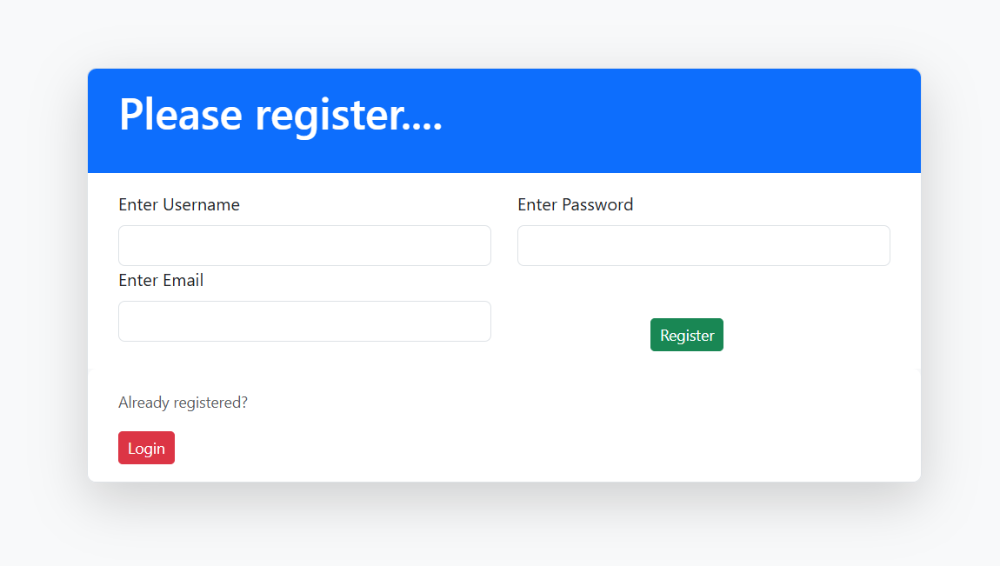
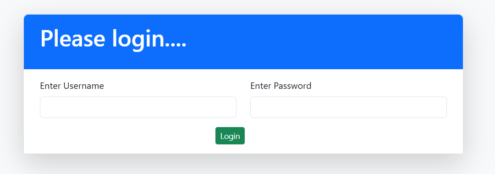
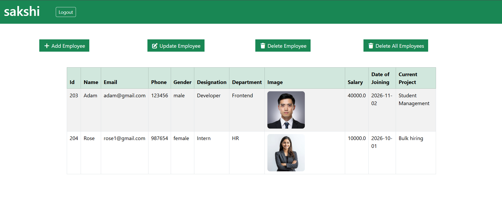

# Employee Management System

A web-based Employee Management System built using Java, Spring Boot, Spring Data JPA, Hibernate and MySQL. The application allows users to register, log in and manage employee records through a dashboard.

## Features

- User registration and login
- Email-based account verification
- Employee dashboard
- Add new employee records
- Edit employee details
- View employee records
- Delete individual employee records
- Delete all employee records
- Employee profile image upload

## Technologies Used

-Java 17 – Programming language

-Spring Boot 3.5.3 – Backend framework

-Spring MVC – Web application architecture

-Spring Data JPA – Database operations

-Hibernate – ORM

-MySQL – Database

-JSP – Frontend

-Maven – Dependency management

-Bootstrap – UI styling

## Project Structure

## Project Structure

| Folder / File |
|---|
| **EmployeeManagementSystem** |
| ├── src |
| │   ├── main |
| │   │   ├── java |
| │   │   │   └── com.MainApp |
| │   │   │       ├── Controller |
| │   │   │       │   ├── EmployeeCrud.java |
| │   │   │       │   └── RegisterLoginLogout.java |
| │   │   │       ├── Entity |
| │   │   │       │   ├── Employee.java |
| │   │   │       │   └── User.java |
| │   │   │       ├── Repository |
| │   │   │       │   ├── EmployeeRepository.java |
| │   │   │       │   └── UserRepository.java |
| │   │   │       ├── Service |
| │   │   │       │   ├── EmployeeService.java |
| │   │   │       │   └── UserService.java |
| │   │   │       └── EmployeeManagementSystemApplication.java |
| │   │   ├── resources |
| │   │   │   └── application.properties |
| │   │   └── webapp |
| │   │       ├── Home.jsp |
| │   │       ├── Login.jsp |
| │   │       ├── Registration.jsp |
| │   │       └── images |
| │   └── test |
| ├── screenshots |
| ├── .mvn |
| ├── .gitignore |
| ├── mvnw |
| ├── mvnw.cmd |
| ├── pom.xml |
└── README.md |

## Prerequisites

Before running the project, install:

- JDK 17
- MySQL Server
- Eclipse IDE
- Maven (optional, as Maven Wrapper is included)

## Database Configuration

1. Start your MySQL server.
2. Create a database:
CREATE DATABASE myproject;
3. Configure your MySQL username and password in `src/main/resources/application.properties`.

4. Hibernate is configured with `spring.jpa.hibernate.ddl-auto=update` to create and update database tables automatically.

## Run Locally

1. Clone this repository:

    git clone YOUR_GITHUB_REPOSITORY_URL

2. Open Eclipse.
3. Select **File → Import → Maven → Existing Maven Projects**.
4. Select the cloned project directory.
5. Wait for Maven dependencies to download.
6. Configure your database and email settings.
7. Locate `EmployeeManagementSystemApplication.java`.
8. Right-click and select **Run As → Spring Boot App**.

Alternatively, run using Maven Wrapper on Windows:
mvnw.cmd spring-boot:run
## Application URLs

| Page | URL |
|---|---|
| Registration | http://localhost:8081/RegistrationPage |
| Login | http://localhost:8081/LoginPage |

## Screenshots

### Registration Page

### Login Page

### Employee Dashboard

## Future Improvements

- Password encryption
- Improved authentication and authorization
- Input validation and error handling
- Responsive UI improvements
- Deployment to a cloud platform

## Author

Sakshi Deepak Mane

Java Full Stack Developer

